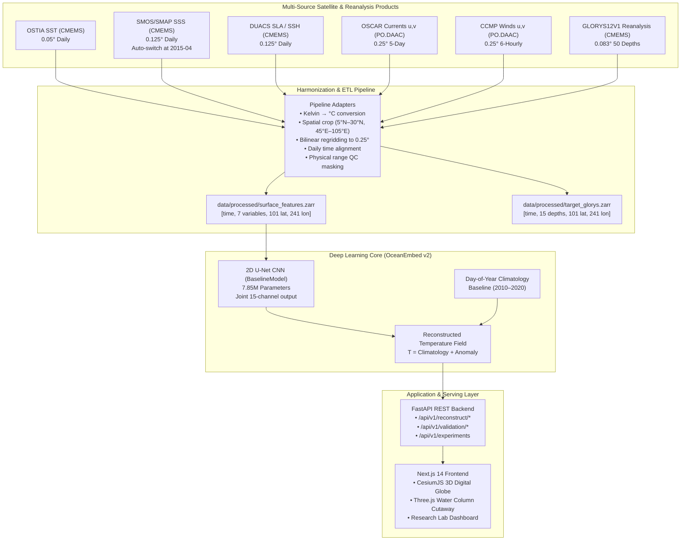
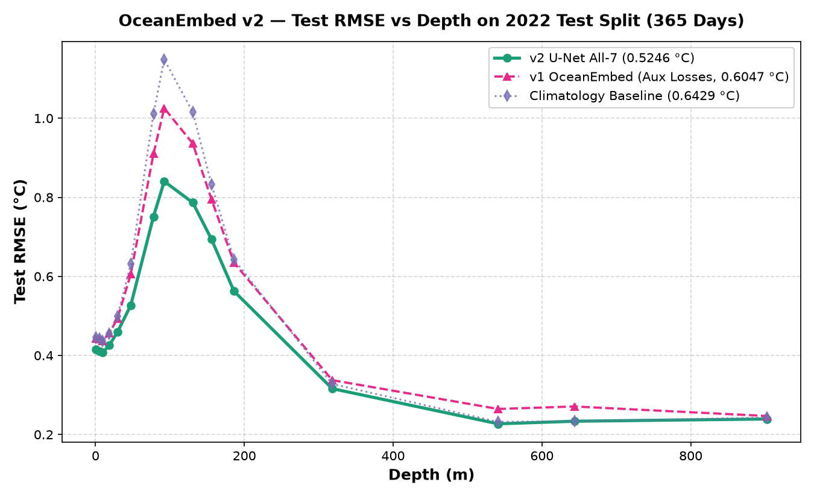

# OceanEmbed — Satellite-Driven Subsurface Ocean Temperature Reconstruction

> **Smart India Hackathon (SIH 2026) | Problem Statement SIH26066**<br/>
> **Ministry of Earth Sciences (MoES) / INCOIS**<br/>
> *An end-to-end deep learning platform inferring 3D ocean thermal structure down to 1,000 meters across 15 depth levels from multi-sensor satellite observations.*

---

## Overview

### The Problem
Earth observation satellites provide high-resolution, daily views of sea surface temperature, salinity, sea level anomalies, surface currents, and surface winds. However, optical and radar satellite sensors cannot penetrate beneath the surface layer. Direct subsurface measurements rely on in-situ instruments like autonomous profiling floats (the Argo network), which offer high vertical accuracy but are spatially sparse (~300 km apart) and cycle only every 10 days.

### The OceanEmbed Approach
OceanEmbed bridges the gap between wide-coverage satellite observations and depth-resolved ocean thermal structure. By exploiting the physical coupling between surface signals (notably sea level height variations reflecting vertically integrated density changes) and subsurface dynamics, OceanEmbed uses a 2D convolutional deep learning model (U-Net) to reconstruct 3D subsurface temperature fields:

- **Geographic Domain:** North Indian Ocean ($5.0^\circ\text{N}–30.0^\circ\text{N}, 45.0^\circ\text{E}–105.0^\circ\text{E}$), covering the Arabian Sea, Bay of Bengal, and equatorial waters.
- **Horizontal Resolution:** Canonical $0.25^\circ \times 0.25^\circ$ daily grid ($101 \text{ lat} \times 241 \text{ lon}$).
- **Vertical Reach:** 15 standard depth levels from surface to $1,000\text{ m}$ ($0.49, 5.08, 9.57, 18.50, 29.44, 47.37, 77.85, 92.33, 130.67, 155.85, 186.13, 318.13, 541.09, 643.57, \text{and } 902.34\text{ m}$).

---

## What OceanEmbed Does

- **Subsurface Temperature Reconstruction:** Predicts 3D temperature fields across 15 vertical depth layers from 7 surface observation channels.
- **Fast Inference API:** Serves point profile reconstructions (~70 ms), 2D horizontal depth slices, timeseries, and regional basin statistics via a FastAPI REST service.
- **Interactive 3D Digital Twin:** Offers an interactive web platform built with CesiumJS and Three.js featuring 3D globe visualization, depth-level slicing, dynamic colormaps, and water-column cutaways.
- **Research & Benchmarking Suite:** Features an interactive Research Lab dashboard tracking 8 systematic ablation experiments, depth-wise error breakdowns, and regional regime evaluations.
- **Multi-Source Data Harmonization:** Preprocesses multi-satellite NetCDF products from CMEMS and NASA PO.DAAC into canonical, standardized daily Zarr stores.

---

## How It Works



---

## Data & Scientific Basis

OceanEmbed uses seven surface observation channels as inputs and evaluates against GLORYS12V1 reanalysis targets and independent Argo floats:

| Dataset | Provider | Variable | Processing Applied | Role |
| :--- | :--- | :--- | :--- | :--- |
| **OSTIA SST** | UK Met Office / CMEMS | `analysed_sst` | Kelvin $\to$ °C, regridded 0.05° to 0.25° | Surface Input (Channel 1) |
| **Multi-Obs SSS** | Copernicus Marine (CMEMS) | `sos` | SMOS-only pre-2015 → merged SMAP+SMOS post-2015, regridded 0.125° to 0.25°, QC (20–42 PSU) | Surface Input (Channel 2) |
| **DUACS Altimetry** | CNES / CMEMS | `sla` | Sea Level Anomaly extracted, regridded to 0.25° | Surface Input (Channel 3) |
| **OSCAR v2.0** | NASA PO.DAAC / Earthdata | `u`, `v` | Coordinate standardization, 5-day to daily interpolation | Surface Input (Channels 4 & 5) |
| **CCMP v3.1** | NASA PO.DAAC / Earthdata | `uwnd`, `vwnd` | 6-hourly to daily mean aggregation | Surface Input (Channels 6 & 7) |
| **GLORYS12V1** | Mercator Ocean / CMEMS | `thetao` | Regridded 0.083° to 0.25°, 15 standard depths extracted | Reanalysis Training Target |
| **Argo Profiles** | IFREMER GDAC / ArgoVis | `TEMP`, `PRES` | Quality flags (QC 1/2), collocated depth matching | Independent Holdout Validation |

> [!NOTE]
> **Problem Statement Alignment & Upstream Catalog Notes:**
> All input products directly fulfill the official SIH26066 recommendations. Some dataset product identifiers or native grid configurations differ slightly from the original problem statement text because operational catalogs (CMEMS, PO.DAAC) evolve over time:
> - **SSS:** Merged SMAP+SMOS (`cmems_obs-mob_glo_phy-sss_my_multi_P1D`, DOI: `10.48670/moi-00051`) begins in April 2015 (SMAP launch); dates from 2010–2015 automatically use the SMOS-only product (`cmems_obs-mob_glo_phy-sss_my_smos_P1D`).
> - **SSH:** Modern CMEMS DUACS (`cmems_obs-sl_glo_phy-ssh_my_allsat-l4-duacs-0.125deg_P1D`, DOI: `10.48670/moi-00145`) is served natively at 0.125° and regridded to canonical 0.25° by our adapter.
> - **Winds:** Uses analysis-ready 0.25° gridded CCMP v3.1 (`CCMP_WINDS_10M6HR_L4_V3.1`) rather than orbital swath data, daily-averaged from 6-hourly snapshots.
> - **Splits:** **Training:** 2010–2020 (4,018 daily snapshots, 11 years) | **Validation:** 2021 (365 snapshots) | **Test:** 2022 (365 snapshots) | **Operational / Held-Out:** 2023 | **Argo Float In-Situ Validation:** 2020–2022 (8,923 physical profiles across NIO).
>
> For comprehensive dataset documentation, DOIs, download scripts, and raw vs. processed comparisons, see [dataset_documentation.md](dataset_documentation.md).

---

## Model & Methodology

### 1. Anomaly Formulation
Direct prediction of absolute temperature often leads neural networks to memorize the seasonal cycle rather than learning subsurface responses. OceanEmbed formulates reconstruction as an anomaly prediction problem:

$$\hat{T}(x, y, z, t) = T_{\text{clim}}(\text{doy}(t), z, y, x) + f_\theta(\mathbf{X}_{\text{surface}}(t))$$

where $T_{\text{clim}}$ is a day-of-year lookup table computed from 2010–2020 GLORYS reanalysis, and $f_\theta$ is the deep neural network trained to predict deviations from historical averages using mean squared error (MSE) loss on valid ocean pixels.

### 2. Architecture Selection: U-Net vs. Fourier Decoder
Earlier experiments evaluated an architecture using a ResNet spatial encoder combined with a continuous Fourier coordinate depth MLP decoder that queried each depth level independently. However, systematic benchmarking revealed that evaluating depth coordinates in isolation lacked direct layer-to-layer communication, resulting in degraded accuracy around the sharp thermocline boundary ($50–200\text{ m}$).

The current model (`runs/_final_v2/model_v2.pt`) employs a 4-level **2D U-Net CNN encoder-decoder with skip connections** (~7.85M parameters):
- **Inputs:** 7 surface channels (plus valid ocean masks) on the $101 \times 241$ grid.
- **Skip Connections:** Preserve horizontal spatial detail across resolution levels.
- **Joint 15-Channel Output Head:** Predicts all 15 vertical depth anomalies simultaneously; joint 15-channel prediction learns cross-depth relationships and performed better in the evaluated experiments.

For the structural evaluation of the decoder architectures, see [docs/finding_fourier_decoder_limitations.md](docs/finding_fourier_decoder_limitations.md).

---

## Results & Validation

All reported metrics are verified directly from tracked experiment checkpoints and evaluation runs in the repository.

### 1. Test Split Evaluation vs. GLORYS Reanalysis (2022 Split)
Evaluated across all 365 daily fields of 2022 over the North Indian Ocean at 15 depth levels (56,277,525 valid ocean points; 133,266,975 full-grid points):

| Evaluation Metric | OceanEmbed v2 (Ocean-Masked Headline) | OceanEmbed v2 (Full-Grid Legacy*) | Climatology Baseline (Ocean-Masked) | Improvement |
| :--- | :---: | :---: | :---: | :---: |
| **Overall RMSE** | **0.8072 °C** | 0.5246 °C | 0.9893 °C | **+18.40%** |
| **Overall MAE** | **0.5520 °C** | 0.2331 °C | 0.6440 °C | +14.28% |
| **Bias** | **-0.0367 °C** | -0.0155 °C | -0.1672 °C | — |
| **Coefficient of Determination ($R^2$)** | **0.9884** | 0.9980 | 0.9826 | — |
| **Pearson Correlation ($r$)** | **0.9942** | 0.9990 | 0.9915 | — |

*\*Full-grid RMSE (0.5246 °C) includes zero-error land pixels ($\text{RMSE}_{\text{full}} = \text{RMSE}_{\text{ocean}} \times \sqrt{0.4223}$). We report ocean-masked metrics as the primary headline; the 18.4% skill gain holds identically across both domains.*

#### Error Breakdown by Depth Band (Ocean-Masked)
- **Mixed Layer ($0–50\text{ m}$):** **0.6483 °C** RMSE
- **Thermocline ($50–200\text{ m}$):** **1.1573 °C** RMSE
- **Deep Ocean ($200–1,000\text{ m}$):** **0.4150 °C** RMSE



### 2. Variable Ablation: The SLA Dominance Finding
Systematic ablation of input channels (evaluated on the full-grid benchmark) showed that multi-sensor inputs are beneficial, with Sea Level Anomaly (SLA) contributing the largest share of subsurface skill:

| Variant | Input Variables | Full-Grid RMSE (°C) | Improvement vs. Clim | Key Takeaway |
| :--- | :--- | :---: | :---: | :--- |
| **Climatology** | None *(Historical Day-of-Year Mean)* | 0.6429 | 0.0% | Baseline lookup table |
| **V1** | SST only | 0.6181 | -3.9% | Surface temperature alone provides weak subsurface constraints (errors reach 1.1 °C at 92 m) |
| **V2** | SST + SLA | 0.5363 | -16.6% | **SLA accounts for 87.5% of total multi-variable skill gain** |
| **V3** | SST + SLA + SSS | 0.5306 | -17.5% | Salinity refines mixed-layer halocline and upper pycnocline |
| **V4 (v2)** | All 7 Channels (SST, SSS, SLA, Winds, Currents) | **0.5246** | **-18.4%** | Atmospheric and advective forcing refine surface boundary shear |

**Physical Context:** Satellite-derived Sea Level Anomaly reflects vertically integrated density changes (steric height). Under a two-layer ocean approximation, sea surface displacement ($\eta$) is directly proportional to thermocline displacement ($h' \approx -\frac{g}{g'} \eta$). Altimetry provides the model with direct information about thermocline depressions and elevations associated with mesoscale eddies and planetary waves. For detailed ablation analysis, see [docs/phase6_findings.md](docs/phase6_findings.md).

### 3. Independent In-Situ Argo Float Validation (2020–2022)
To verify generalization against real in-situ observations rather than reanalysis alone, OceanEmbed predictions were collocated with **8,881 physical Argo float profiles** across the North Indian Ocean (post-Issue-#22 depth-grid corrected collocation):

- **North Indian Ocean Basin RMSE:** **0.915 °C** (0.9148 °C, Bias: +0.042 °C, Pearson $r$: 0.992)
- **Arabian Sea (5,940 profiles):** **0.943 °C** (0.9431 °C) RMSE
- **Bay of Bengal (2,780 profiles):** **0.844 °C** (0.8437 °C) RMSE

For regional and seasonal breakdowns across monsoon regimes, see [docs/FINAL_RESULTS.md](docs/FINAL_RESULTS.md) and [docs/phase7_seasonal_analysis.md](docs/phase7_seasonal_analysis.md).

---

## Platform

```
┌─────────────────────────────────────────────────────────────┐
│                      Next.js 14 Frontend                    │
│  ┌───────────────────────┐       ┌───────────────────────┐  │
│  │   CesiumJS 3D Globe   │       │   Research Lab Suite  │  │
│  │   • Observation maps  │       │   • Model benchmarks  │  │
│  │   • Argo float replay │       │   • Variable ablation │  │
│  │   • Three.js cutaway  │       │   • Regime analysis   │  │
│  └───────────┬───────────┘       └───────────┬───────────┘  │
└──────────────┼───────────────────────────────┼──────────────┘
               │  HTTP / JSON                  │
               ▼                               ▼
┌─────────────────────────────────────────────────────────────┐
│                     FastAPI REST Backend                    │
│  • /api/v1/reconstruct/profile     • /api/v1/experiments    │
│  • /api/v1/reconstruct/map         • /api/v1/validation/*   │
│  • /api/v1/reconstruct/timeseries  • /api/v1/model/info     │
└──────────────────────────────┬──────────────────────────────┘
                               │  Singleton Inference
                               ▼
┌─────────────────────────────────────────────────────────────┐
│                PyTorch Inference Engine & Zarr              │
│  • BaselineModel U-Net (runs/_final_v2/model_v2.pt)         │
│  • Canonical Zarr arrays & Climatology cache                │
└─────────────────────────────────────────────────────────────┘
```

- **Frontend (`frontend/`):** Next.js 14 (App Router) client with CesiumJS for 3D globe visualization, Three.js (@react-three/fiber) for vertical water-column cutaway perspectives, Recharts for vertical temperature profile charts, and TanStack React Query for cached data fetching.
- **Research Lab (`frontend/app/research-lab/`):** Interactive benchmarking environment displaying ablation studies, model iterations, and regional regime breakdowns.
- **Backend API (`backend/api/`):** FastAPI application with automatic OpenAPI documentation (`/docs`), GZip response compression, request ID tracing, and frontend route compatibility. For full API documentation, see [backend/api/README.md](backend/api/README.md).

---

## Quickstart

### Running the Platform with Existing Model Artifacts
The quickstart below runs the FastAPI backend and Next.js frontend using the pre-computed model weights and data stores included in the repository. **No external satellite credentials are required** for this setup.

#### 1. Prerequisites
- **Python:** 3.11 or 3.12
- **Node.js:** 18+ or 20+ (with npm)
- **System Tools:** `curl`, `git`

#### 2. Backend Setup
1. Create and activate a Python virtual environment:
   ```bash
   python -m venv .venv
   # Windows (PowerShell):
   .venv\Scripts\Activate.ps1
   # Linux / macOS:
   source .venv/bin/activate
   ```
2. Install Python dependencies:
   ```bash
   pip install --upgrade pip
   pip install -r backend/requirements.txt
   ```
3. Initialize the environment template:
   ```bash
   cp backend/.env.example backend/.env
   ```
4. Start the FastAPI development server:
   ```bash
   uvicorn backend.api.main:app --host 0.0.0.0 --port 8000 --reload
   ```
   Check status at [http://localhost:8000/health](http://localhost:8000/health) or explore endpoints at [http://localhost:8000/docs](http://localhost:8000/docs).

#### 3. Frontend Setup
1. In a separate terminal, install dependencies:
   ```bash
   cd frontend
   npm install
   ```
2. Start the Next.js development server:
   ```bash
   npm run dev
   ```
3. Open [http://localhost:3000](http://localhost:3000) in your browser. The 3D globe explorer is at `/explorer` and the research dashboard is at `/research-lab`.

#### 4. Containerized Execution (Optional)
To build and run the backend via Docker:
```bash
docker build -t oceanembed-backend .
docker run -p 8000:8000 oceanembed-backend
```

---

## Optional Raw-Data Pipeline

> [!NOTE]
> This workflow is **optional**. It is only necessary if you intend to download raw satellite products from external providers from scratch and generate new Zarr tensor stores.

Running the full raw-data ETL requires valid registration credentials:
- **Copernicus Marine Service (CMEMS):** Set `COPERNICUSMARINE_SERVICE_USERNAME` and `COPERNICUSMARINE_SERVICE_PASSWORD` in `backend/.env`.
- **NASA Earthdata:** Set `EARTHDATA_USERNAME` and `EARTHDATA_PASSWORD` in `backend/.env`.

Commands:
```bash
# 1. Download raw products and run full regridding/Zarr generation
python backend/pipeline/run_pipeline.py

# 2. Run preprocessing only on existing raw NetCDF files (skip download)
python backend/scripts/ingest.py --skip-download

# 3. Validate generated Zarr stores against canonical grid specifications
python backend/pipeline/validate_pipeline.py
```

---

## Repository Structure

```
OceanEmbed/
├── backend/                  # Backend application, ML models, and data pipeline
│   ├── api/                  # FastAPI app, REST routes, Pydantic schemas, and services
│   ├── config.py             # Application settings and environment configuration
│   ├── ocean_embed/          # PyTorch models (U-Net, Fourier baseline), losses, metrics
│   ├── pipeline/             # Satellite adapters, GridProcessor, and ETL orchestration
│   ├── requirements.txt      # Python package dependencies
│   ├── scripts/              # Ingestion, validation calculation, and cron scripts
│   └── tests/                # Test suite (API endpoints and data harmonization)
├── frontend/                 # Next.js 14 web application
│   ├── app/                  # App Router pages (landing, explorer, research-lab, methodology)
│   ├── components/           # Cesium globe, Three.js cutaway, Recharts, and UI panels
│   ├── lib/                  # TanStack Query API hooks, Zustand stores, fixtures
│   └── package.json          # Node.js dependencies and run scripts
├── docs/                     # Technical reports, scientific findings, and validation studies
├── notebooks/                # Jupyter exploratory and data sanity notebooks
├── runs/                     # Model checkpoints, ablation results, and evaluation figures
│   └── _final_v2/            # Frozen OceanEmbed v2 model (U-Net) and evaluation outputs
├── .github/                  # Issue and Pull Request templates
├── dataset_documentation.md  # Detailed reference for every satellite and in-situ dataset
└── Dockerfile                # Multi-stage Docker configuration for backend deployment
```

---

## Current Limitations & Future Roadmap

### Current Limitations
- **Geographic Boundary:** The trained model and grid configurations are restricted to the North Indian Ocean ($5^\circ\text{N}–30^\circ\text{N}, 45^\circ\text{E}–105^\circ\text{E}$). Coordinates outside this bounding box are outside the model domain.
- **Thermocline Error Behavior:** While mixed-layer ($<0.45^\circ\text{C}$) and deep-ocean ($<0.26^\circ\text{C}$) errors are low, RMSE peaks around the main thermocline ($50–200\text{ m}$, reaching $0.84^\circ\text{C}$ at $92\text{ m}$) where vertical temperature gradients and non-linear internal wave activity are highest.
- **Pre-2015 SSS Temporal Density:** SMAP satellite observations began in April 2015. The pipeline automatically switches between the SMOS-only product (`cmems_obs-mob_glo_phy-sss_my_smos_P1D`) for dates before 2015-04-01 and the merged SMAP+SMOS product for dates after. However, the SMOS-only era has slightly lower spatial and temporal sampling density compared to the merged era.
- **Spatial Resolution:** The canonical $0.25^\circ \times 0.25^\circ$ (~28 km) grid smooths sub-mesoscale phenomena and near-shore coastal boundaries.

### Planned Enhancements
- **Cross-Attention Decoders:** Incorporating cross-depth attention to assimilate sparse, irregular in-situ float profiles alongside gridded satellite fields.
- **Subsurface Salinity Reconstruction:** Expanding the target tensor to predict vertical salinity ($S(z)$) and derive acoustic sound-speed profiles.
- **Domain Expansion:** Extending training coverage to the wider Indian Ocean basin and equatorial belts.

---

## Documentation

- **Dataset Reference:** [dataset_documentation.md](dataset_documentation.md) — Source products, DOIs, preprocessing steps, and raw vs. processed schemas.
- **Methodology & Architecture Study:** [docs/finding_fourier_decoder_limitations.md](docs/finding_fourier_decoder_limitations.md) — Structural comparison of Fourier MLP decoders vs. joint-depth U-Net convolution.
- **Ablation Studies:** [docs/phase6_findings.md](docs/phase6_findings.md) — Variable ablation and physical analysis of SLA dominance.
- **Validation Reports:** [docs/FINAL_RESULTS.md](docs/FINAL_RESULTS.md) and [docs/phase7_seasonal_analysis.md](docs/phase7_seasonal_analysis.md) — Verified test metrics and in-situ Argo collocation.
- **Backend API Reference:** [backend/api/README.md](backend/api/README.md) — REST endpoints, schemas, request/response examples.
- **Pipeline Configuration:** [backend/pipeline/pipeline_config.yaml](backend/pipeline/pipeline_config.yaml) — Spatial domain, depth coordinates, and product IDs.

---

## Contributing

Contributions, bug reports, and enhancements are welcome:

1. **Issue Tracking:** Use the [Issue Template](.github/ISSUE_TEMPLATE.md) to report reproducible bugs or suggest enhancements.
2. **Pull Requests:** Follow the [Pull Request Template](.github/PULL_REQUEST_TEMPLATE.md), describe testing steps, and verify that changes pass existing tests.
3. **Data Provenance Standard:** In accordance with project research guidelines, all benchmark results and metrics submitted must include verifiable computation provenance and checkpoint hashes. Mock or synthetic results are strictly prohibited.
4. **Running Tests:**
   ```bash
   pytest backend/tests/test_api.py
   pytest backend/tests/test_harmonization.py
   cd frontend && npm run lint
   ```

---

## Acknowledgments & Data Sources

OceanEmbed relies on public Earth observation and ocean reanalysis data from the following institutions:

- **Copernicus Marine Environment Monitoring Service (CMEMS):**
  - OSTIA Sea Surface Temperature (DOI: [10.48670/moi-00168](https://doi.org/10.48670/moi-00168))
  - Multi-Obs Sea Surface Salinity — Merged SMAP+SMOS (DOI: [10.48670/moi-00051](https://doi.org/10.48670/moi-00051))
  - SMOS-Only Sea Surface Salinity (pre-2015 fallback)
  - DUACS Multi-Mission Altimetry (DOI: [10.48670/moi-00145](https://doi.org/10.48670/moi-00145))
  - GLORYS12V1 Global Ocean Reanalysis (DOI: [10.48670/moi-00021](https://doi.org/10.48670/moi-00021))
- **NASA Physical Oceanography Distributed Active Archive Center (PO.DAAC):**
  - OSCAR Ocean Surface Current Analysis Real-time v2.0
  - CCMP Cross-Calibrated Multi-Platform 10m Surface Winds v3.1
- **International Argo Program / IFREMER GDAC / ArgoVis:**
  - Real-time and delayed-mode Argo profiling float observations in the Indian Ocean.
- **INCOIS (Indian National Centre for Ocean Information Services) & Ministry of Earth Sciences (MoES), Government of India.**
