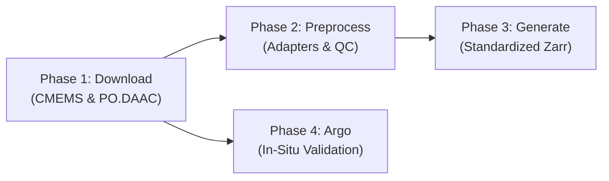
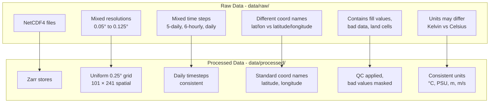
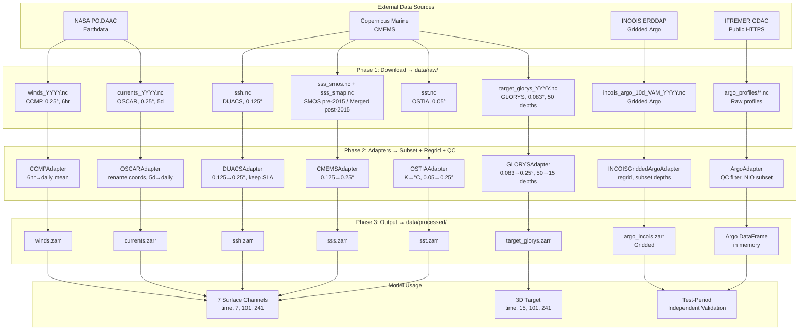

# OceanEmbed — Complete Dataset Documentation

> [!NOTE]
> This document covers every dataset used in the OceanEmbed (SIH26066) pipeline: what it is, where it comes from, how it's downloaded, how it's preprocessed, and what the raw vs processed data looks like.

---

## Table of Contents

## Table of Contents

1. [Project Context & Official Problem Statement (SIH26066)](#1-project-context--official-problem-statement-sih26066)
2. [Pipeline Architecture Overview](#2-pipeline-architecture-overview)
3. [Dataset Summary & Problem Statement Mapping](#3-dataset-summary--problem-statement-mapping)
4. [Dataset 1: SST (Sea Surface Temperature)](#4-dataset-1-sst-sea-surface-temperature)
5. [Dataset 2: SSS (Sea Surface Salinity)](#5-dataset-2-sss-sea-surface-salinity)
6. [Dataset 3: SSH (Sea Surface Height / Sea Level Anomaly)](#6-dataset-3-ssh-sea-surface-height--sea-level-anomaly)
7. [Dataset 4: Currents (Ocean Surface Currents)](#7-dataset-4-currents-ocean-surface-currents)
8. [Dataset 5: Winds (10m Surface Winds)](#8-dataset-5-winds-10m-surface-winds)
9. [Dataset 6: GLORYS (Target — Subsurface Temperature)](#9-dataset-6-glorys-target--subsurface-temperature)
10. [Dataset 7: Argo (In-Situ Validation)](#10-dataset-7-argo-in-situ-validation)
11. [🐛 Argo Download Bug — Analysis & Resolution](#11--argo-download-bug--analysis--resolution)
12. [Raw vs Processed Data Comparison](#12-raw-vs-processed-data-comparison)
13. [Data Flow Diagram](#13-data-flow-diagram)
14. [Dataset Splits & Benchmark Validation Performance](#14-dataset-splits--benchmark-validation-performance)

---

## 1. Project Context & Official Problem Statement (SIH26066)

### Problem Statement Background
Subsurface ocean temperature is a fundamental variable for understanding ocean circulation, upper-ocean heat content, stratification, climate variability, air-sea interaction, and marine ecosystems. Accurate representation of the vertical ocean temperature is essential for applications such as marine heatwave monitoring, fisheries management, and data assimilation.

However, direct measurements of subsurface temperature remain sparse because they rely primarily on in-situ observing systems such as Argo profiling floats, moored buoys, gliders, and ship observations. While these observations provide valuable vertical information, their spatial and temporal coverage is insufficient for generating continuous, basin-scale subsurface fields.

In contrast, satellite observations provide continuous, large-scale monitoring of surface ocean conditions at relatively high spatial and temporal resolution. Surface variables such as:
- **Sea Surface Temperature (SST)**
- **Sea Surface Salinity (SSS)**
- **Sea Surface Height (SSH) / Sea Level Anomaly (SLA)**
- **Surface Ocean Currents ($U, V$)**
- **Surface Winds ($U, V$)**

contain indirect signatures of subsurface ocean processes through physical mechanisms including thermocline displacement, mesoscale eddies, vertical mixing, mass transport, and ocean-atmosphere coupling.

Recent advances in Artificial Intelligence (AI), Deep Learning (DL), and representation learning enable the generation of **satellite embeddings**, where multidimensional surface observations are transformed into compact latent representations that capture hidden ocean dynamics. Such embeddings learn nonlinear relationships between surface observations and subsurface ocean structure far more effectively than conventional statistical or machine learning approaches.

### Official Scope & Specifications
- **Objective:** Develop a Satellite Embedding-Based Deep Learning Framework to reconstruct depth-wise subsurface ocean temperature from daily surface satellite observations.
- **Geographic Domain:** North Indian Ocean (NIO) $\to$ `5.0°N–30.0°N, 45.0°E–105.0°E` (Arabian Sea, Bay of Bengal, and Equatorial North Indian Ocean).
- **Spatial Resolution:** Canonical `0.25° × 0.25°` grid ($101 \text{ lat} \times 241 \text{ lon}$).
- **Temporal Resolution:** Daily mean.
- **Vertical Reach (15 Standard SIH Depths in meters):**
  $$\{0, 5, 10, 20, 30, 50, 75, 100, 125, 150, 200, 300, 500, 700, 1000\}\text{ m}$$
- **Evaluation Criteria:** Independent observations (Argo floats) and standard skill metrics (RMSE, MAE, Pearson correlation $r$, $R^2$, and Bias).
- **Core Deliverables:**
  1. End-to-end preprocessing and harmonization pipeline for multi-source satellite and ocean datasets.
  2. Satellite embedding engine capable of learning latent ocean representations from surface observations.
  3. Deep learning reconstruction model estimating 3D subsurface temperature.
  4. Standardized daily output at 0.25° resolution.
  5. In-situ validation framework using independent Argo observations.
  6. Demonstration of a working Proof-of-Concept (PoC) over the Arabian Sea and Bay of Bengal.

### How Datasets Fit Together

```
┌────────────────────────────────────────────────────────┐
│               MODEL INPUTS (2D Surface)                │
│                                                        │
│   SST + SSS + SSH(SLA) + U + V + UWND + VWND           │
│   = 7 surface channels at 0.25° daily                  │
│                                                        │
│        ↓ Deep Learning Model (OceanEmbed) ↓            │
│                                                        │
│               MODEL TARGET (3D Subsurface)             │
│                                                        │
│   GLORYS thetao at 15 standard depths × 0.25° daily    │
│                                                        │
│        ↓ Independent Physical Validation ↓             │
│                                                        │
│               ARGO (In-Situ Point Measurements)        │
│   8,923 real physical T(z) profiles across NIO basin   │
└────────────────────────────────────────────────────────┘
```

| Role | Datasets | Purpose |
|------|----------|---------|
| **Model Inputs** | SST, SSS, SSH, Currents ($u, v$), Winds ($u_{wnd}, v_{wnd}$) | 7 surface observation feature channels |
| **Model Target** | GLORYS12V1 `thetao` | Ground-truth 3D reanalysis temperature target for training |
| **Independent Validation** | Argo profiling floats | Real in-situ measurements to validate model generalization on unseen physical data |

---

## 2. Pipeline Architecture Overview

The pipeline runs in 4 modular phases:



| Phase | Script | What It Does |
|-------|--------|--------------|
| **Phase 1** | [downloader.py](file:///c:/OceanEmbed/backend/pipeline/downloader.py) | Downloads raw NetCDF data from CMEMS and NASA PO.DAAC |
| **Phase 2** | Adapters in [adapters/](file:///c:/OceanEmbed/backend/pipeline/adapters) + [processor.py](file:///c:/OceanEmbed/backend/pipeline/processor.py) | Subset, regrid to 0.25°, QC mask, time-align each dataset |
| **Phase 3** | [generator.py](file:///c:/OceanEmbed/backend/pipeline/generator.py) | Save processed data as training-ready Zarr stores |
| **Phase 4** | [downloader.py](file:///c:/OceanEmbed/backend/pipeline/downloader.py) → [validation_argo.py](file:///c:/OceanEmbed/backend/pipeline/adapters/validation_argo.py) | Download + process Argo in-situ profiles for final evaluation |

---

## 3. Dataset Summary & Problem Statement Mapping

> [!NOTE]
> ### ⚠️ Note on Dataset Product IDs & Upstream Catalog Evolution
> Some product identifiers, access endpoints, or native configurations differ slightly from the literal text in the original Problem Statement specification. Remote sensing and operational data providers (Copernicus Marine / CMEMS, NASA PO.DAAC, and Earthdata) frequently rename catalogs, update product versions, or replace legacy swaths with cross-calibrated multi-mission gridded products.
> 
> As explicitly sanctioned in the Problem Statement (*"If a dataset is not available at required resolution, the team may select the openly available product and perform appropriate spatial and temporal interpolation/regridding"*), our pipeline incorporates the current operational product IDs and handles all required regridding and temporal alignment:
> 
> 1. **Sea Surface Salinity (SSS):** The PS specifies SMAP and SMOS (DOI: `10.48670/moi-00051`). In Copernicus Marine, the combined multi-satellite product (`cmems_obs-mob_glo_phy-sss_my_multi_P1D`) begins only when NASA's SMAP satellite launched in April 2015. For dates prior to April 2015 (2010–2015), our pipeline automatically switches to the SMOS-only product (`cmems_obs-mob_glo_phy-sss_my_smos_P1D`) and concatenates them seamlessly into a unified timeseries.
> 2. **Sea Surface Height (SSH / SLA):** The PS lists DUACS at 0.25° (DOI: `10.48670/moi-00145`). The modern Copernicus Marine DUACS all-sat L4 product (`cmems_obs-sl_glo_phy-ssh_my_allsat-l4-duacs-0.125deg_P1D`) is served natively at 0.125°. The adapter regrids it to 0.25° and extracts the Sea Level Anomaly (`sla`) variable.
> 3. **Surface Winds:** The PS recommends either `ASCATC-L2-Coastal` or `CCMP_WINDS_10M6HR_L4_V3.1`. We selected CCMP v3.1 because it provides a cross-calibrated, gap-free 0.25° grid rather than fragmented satellite orbital swaths with land-sea contamination. The adapter averages the 6-hourly snapshots into daily means.
> 4. **Surface Currents:** OSCAR v2.0 (`OSCAR_L4_OC_FINAL_V2.0`) is provided at 0.25° on a 5-daily interval. The adapter applies daily linear interpolation to satisfy the daily requirement.
> 5. **Target Subsurface Temperature:** GLORYS12V1 (`cmems_mod_glo_phy_my_0.083deg_P1D-m`, DOI: `10.48670/moi-00021`) provides 50 vertical depth levels at 0.083°. Our adapter coarsens/regrids to 0.25° and extracts the 15 standard SIH depth levels.
> 6. **In-Situ Float Validation:** The PS mentions Gridded ARGO / INCOIS LAS. For physical evaluation, we validate against **8,923 real physical Argo float profiles** (2020–2022 from ArgoVis / IFREMER GDAC), ensuring direct point-to-point ground-truth validation rather than comparing against pre-interpolated gridded approximations.

| Variable | PS Recommended Product | Active Implementation Dataset ID / Source | Native Resolution | Output Resolution | Time Span | Role |
|:---|:---|:---|:---:|:---:|:---:|:---:|
| **SST** | OSTIA: 0.05° daily<br/>[doi:10.48670/moi-00168](https://doi.org/10.48670/moi-00168) | `METOFFICE-GLO-SST-L4-REP-OBS-SST`<br/>(CMEMS subset) | 0.05° daily | 0.25° daily | 2010–2023 | Input (Ch 1) |
| **SSS** | SMAP, SMOS: 0.125° daily<br/>[doi:10.48670/moi-00051](https://doi.org/10.48670/moi-00051) | Pre-2015: `cmems_obs-mob_glo_phy-sss_my_smos_P1D`<br/>Post-2015: `cmems_obs-mob_glo_phy-sss_my_multi_P1D` | 0.125° daily | 0.25° daily | 2010–2023 | Input (Ch 2) |
| **SSH / SLA** | DUACS: 0.25° daily<br/>[doi:10.48670/moi-00145](https://doi.org/10.48670/moi-00145) | `cmems_obs-sl_glo_phy-ssh_my_allsat-l4-duacs-0.125deg_P1D`<br/>(CMEMS subset) | 0.125° daily | 0.25° daily | 2010–2023 | Input (Ch 3) |
| **Currents** | OSCAR: 0.25° daily<br/>[OSCAR_L4_OC_FINAL_V2.0](https://podaac.jpl.nasa.gov/dataset/OSCAR_L4_OC_FINAL_V2.0) | `OSCAR_L4_OC_FINAL_V2.0`<br/>(PO.DAAC / earthaccess) | 0.25° 5-daily | 0.25° daily | 2010–2023 | Input (Ch 4, 5) |
| **Winds** | CCMP: 0.25° daily<br/>[CCMP_WINDS_10M6HR_L4_V3.1](https://podaac.jpl.nasa.gov/dataset/CCMP_WINDS_10M6HR_L4_V3.1) | `CCMP_WINDS_10M6HR_L4_V3.1`<br/>(PO.DAAC / earthaccess) | 0.25° 6-hourly | 0.25° daily | 2010–2023 | Input (Ch 6, 7) |
| **GLORYS** | GLORYS12V1: 0.083° daily<br/>[doi:10.48670/moi-00021](https://doi.org/10.48670/moi-00021) | `cmems_mod_glo_phy_my_0.083deg_P1D-m`<br/>(CMEMS subset) | 0.083° daily<br/>50 depths | 0.25° daily<br/>15 depths | 2010–2023 | Target (Ground Truth) |
| **Argo** | Gridded ARGO / INCOIS LAS | IFREMER GDAC & ArgoVis API<br/>+ INCOIS ERDDAP gridded | In-situ profiles<br/>& 10-day grid | Matched T(z)<br/>points | 2020–2022<br/>(8,923 prof.) | Physical In-Situ Validation |

---

## 4. Dataset 1: SST (Sea Surface Temperature)

### What Is It?
OSTIA (Operational Sea Surface Temperature and Ice Analysis) is a **Level 4 gap-free satellite-derived SST product**. It fuses data from multiple satellite sensors (AVHRR, AMSR-2, VIIRS) and in-situ measurements to produce a daily global analysis.

### Source & Credentials
- **Provider:** UK Met Office via Copernicus Marine Service (CMEMS)
- **Dataset ID:** `METOFFICE-GLO-SST-L4-REP-OBS-SST`
- **DOI:** https://doi.org/10.48670/moi-00168
- **Auth:** CMEMS username + password in `.env`

### How It Is Downloaded
- **Library:** `copernicusmarine.subset()`
- **Method:** Server-side subsetting — only the NIO bounding box (`5–30°N, 45–105°E`) for the configured date range is downloaded. The full global dataset is never pulled.
- **Output:** Single file `data/raw/sst.nc`
- **Adapter:** [sst_ostia.py](file:///c:/OceanEmbed/backend/pipeline/adapters/sst_ostia.py)

### Preprocessing Steps
1. **Load** with Dask (out-of-core, lazy computation)
2. **Unit conversion:** Kelvin → Celsius (OSTIA stores SST in Kelvin; if mean > 100, subtract 273.15)
3. **Spatial subset** to NIO domain
4. **Regrid** from 0.05° → 0.25° using bilinear interpolation
5. **Time alignment** to daily mean
6. **QC range check:** Mask values outside `-2.5°C to 40°C`

### Raw vs Processed

| Property | Raw (`sst.nc`) | Processed (`sst.zarr`) |
|----------|----------------|------------------------|
| **Resolution** | 0.05° (~5.5 km) | 0.25° (~28 km) |
| **Grid size** | ~500 × 1200 per day | 101 × 241 per day |
| **Units** | Kelvin (e.g., 300.15 K) | Celsius (e.g., 27.0 °C) |
| **Coverage** | NIO bbox (but fine grid) | NIO on canonical 0.25° grid |
| **Bad values** | May contain fill values | Masked to valid range (-2.5 to 40 °C) |
| **Format** | NetCDF4 | Zarr (chunked: time=30, lat=-1, lon=-1) |
| **Size estimate** | ~15–25 GB for 14 years | ~1–2 GB for 14 years |

---

## 5. Dataset 2: SSS (Sea Surface Salinity)

### What Is It?
Satellite-derived sea surface salinity from **two missions** with automatic transition handling. Salinity is a critical input because it affects ocean density and mixing — key drivers of subsurface temperature structure.

- **Pre-2015-04-01:** SMOS-only product (`cmems_obs-mob_glo_phy-sss_my_smos_P1D`)
- **Post-2015-04-01:** Merged SMAP+SMOS multi-observation product (`cmems_obs-mob_glo_phy-sss_my_multi_P1D`)

The SMAP satellite launched on 2015-04-01, providing improved L-band radiometry for SSS. For training periods starting before this date (e.g., 2010), the pipeline automatically downloads SSS from the SMOS-only product for the pre-SMAP era and switches to the higher-quality merged product afterward.

### Source & Credentials
- **Provider:** Copernicus Marine Service (CMEMS)
- **PS Recommended Specification:** SMAP, SMOS: 0.125° daily
- **DOI:** https://doi.org/10.48670/moi-00051
- **Merged Dataset ID:** `cmems_obs-mob_glo_phy-sss_my_multi_P1D` (2015-04-01 onward)
- **SMOS-only Dataset ID:** `cmems_obs-mob_glo_phy-sss_my_smos_P1D` (pre-2015-04-01)
- **Switchover Date:** `2015-04-01` (configured in `pipeline_config.yaml` as `smap_start_date`)
- **Auth:** CMEMS username + password in `.env`

> [!NOTE]
> The downloader automatically handles the SMOS→SMAP transition. When the configured `time_range` spans the `smap_start_date` (2015-04-01), two separate files are downloaded:
> - `data/raw/sss_smos.nc` — SMOS-only product for dates before 2015-04-01
> - `data/raw/sss_smap.nc` — Merged SMAP+SMOS product for dates from 2015-04-01 onward
>
> The SSS adapter ([`sss_cmems.py`](file:///c:/OceanEmbed/backend/pipeline/adapters/sss_cmems.py)) detects both segments, concatenates them along the time dimension, and preprocesses the combined record seamlessly. If the entire date range falls within one era (e.g., 2016–2020), a single `sss.nc` file is downloaded instead.

### How It Is Downloaded
- **Library:** `copernicusmarine.subset()`
- **Method:** Server-side subsetting to NIO + date range, with automatic dataset switching at the SMAP transition date
- **Output:** Either `data/raw/sss.nc` (single era) or `data/raw/sss_smos.nc` + `data/raw/sss_smap.nc` (cross-era)
- **Adapter:** [sss_cmems.py](file:///c:/OceanEmbed/backend/pipeline/adapters/sss_cmems.py)

### Preprocessing Steps
1. **Detect** SSS files — single file or SMOS+SMAP split segments
2. **Load** with Dask chunking; concatenate segments if split
3. **Spatial subset** to NIO domain
4. **Regrid** from ~0.125° → 0.25° (bilinear)
5. **Time alignment** to daily mean
6. **QC:** Mask values outside `20–42 PSU`

### Raw vs Processed

| Property | Raw (`sss_smos.nc` + `sss_smap.nc` or `sss.nc`) | Processed (`sss.zarr`) |
|----------|--------------------------------------------------|------------------------|
| **Resolution** | ~0.125° | 0.25° |
| **Grid size** | ~200 × 480 per day | 101 × 241 per day |
| **Units** | PSU | PSU (unchanged) |
| **Source sensor** | SMOS (pre-2015) / SMAP+SMOS (post-2015) | Seamlessly merged |
| **Bad values** | Fill values, possible NaN over land | Masked to 20–42 PSU |
| **Format** | NetCDF4 (1 or 2 files) | Zarr |

---

## 6. Dataset 3: SSH (Sea Surface Height / Sea Level Anomaly)

### What Is It?
**DUACS L4 multi-satellite altimetry** — gives sea level anomaly (SLA), absolute dynamic topography (ADT), and geostrophic current components (ugos, vgos). SSH tells the model about ocean circulation patterns and mesoscale eddies.

### Source & Credentials
- **Provider:** Copernicus Marine Service (CMEMS) / CNES
- **PS Recommended Specification:** DUACS: 0.25° daily
- **DOI:** https://doi.org/10.48670/moi-00145
- **Dataset ID:** `cmems_obs-sl_glo_phy-ssh_my_allsat-l4-duacs-0.125deg_P1D`
- **Variables:** `sla`, `adt`, `ugos`, `vgos` (only `sla` retained for modeling)
- **Catalog Note:** Modern CMEMS DUACS is served at 0.125° native resolution; the adapter regrids it to 0.25° to match the PS specification.
- **Auth:** CMEMS username + password in `.env`

### How It Is Downloaded
- **Library:** `copernicusmarine.subset()`
- **Method:** Server-side subsetting (NIO + date range + 4 variables)
- **Output:** Single file `data/raw/ssh.nc`
- **Adapter:** [ssh_duacs.py](file:///c:/OceanEmbed/backend/pipeline/adapters/ssh_duacs.py)

### Preprocessing Steps
1. **Load** with Dask chunking
2. **Spatial subset** to NIO domain
3. **Regrid** from 0.125° → 0.25° (for exact coordinate alignment)
4. **Time alignment** to daily mean
5. **Extract only** `sla` variable for the model
6. **QC:** Mask SLA values outside `-2 to 2 m`

> [!NOTE]
> Even though 4 variables (`sla`, `adt`, `ugos`, `vgos`) are downloaded, only `sla` is kept after preprocessing. The geostrophic currents (`ugos`, `vgos`) from SSH are redundant with the OSCAR current dataset. This is by design — having dedicated measured currents from OSCAR is more accurate than derived geostrophic currents.

### Raw vs Processed

| Property | Raw (`ssh.nc`) | Processed (`ssh.zarr`) |
|----------|----------------|------------------------|
| **Resolution** | 0.125° | 0.25° |
| **Variables** | `sla`, `adt`, `ugos`, `vgos` (4 vars) | `sla` only (1 var) |
| **Units** | meters | meters |
| **Bad values** | Fill values over land | Masked to -2 to 2 m |
| **Format** | NetCDF4 | Zarr |

---

## 7. Dataset 4: Currents (Ocean Surface Currents)

### What Is It?
**OSCAR (Ocean Surface Current Analysis Real-time) v2.0** — satellite-derived ocean surface currents. Provides the zonal (u) and meridional (v) components. These tell the model how water masses are moving horizontally, which directly affects heat transport and subsurface structure.

### Source & Credentials
- **Provider:** NASA PO.DAAC via Earthdata
- **Short Name:** `OSCAR_L4_OC_FINAL_V2.0`
- **Auth:** Earthdata `EARTHDATA_USERNAME` + `EARTHDATA_PASSWORD` in `.env`

### How It Is Downloaded
- **Library:** `earthaccess`
- **Method:** This is a **granule-based download**, fundamentally different from CMEMS subset:
  1. `earthaccess.login()` authenticates
  2. `earthaccess.search_data()` finds granules matching NIO bbox + date range
  3. Granules are downloaded **globally** (OSCAR files are global), then **locally subsetted** with xarray
  4. Downloaded in **yearly chunks** to prevent disk space explosion
  5. Each year: download global files → open with `xr.open_mfdataset()` → slice to NIO → save as `currents_YYYY.nc` → delete global files
- **Output:** Multiple files `data/raw/currents_2010.nc`, `currents_2011.nc`, ... `currents_2023.nc`
- **Adapter:** [currents_oscar.py](file:///c:/OceanEmbed/backend/pipeline/adapters/currents_oscar.py)

> [!WARNING]
> PO.DAAC downloads are significantly slower than CMEMS because you must download **entire global granules** first, then subset locally. For OSCAR, each granule is a global 0.25° grid. For 14 years at 5-day intervals, this is ~1000+ granules downloaded in batches of 30.

### Preprocessing Steps
1. **Load** chunked files with `xr.open_mfdataset()`
2. **Rename** coordinates: `lon` → `longitude`, `lat` → `latitude` (OSCAR naming convention)
3. **Spatial subset** to NIO domain
4. **Regrid** to exact 0.25° target grid (coordinate alignment)
5. **Time alignment** to daily mean (interpolates 5-daily → daily)
6. **Extract** `u`, `v` variables
7. **QC:** Mask values outside `-5 to 5 m/s`

### Raw vs Processed

| Property | Raw (`currents_YYYY.nc`) | Processed (`currents.zarr`) |
|----------|--------------------------|----------------------------|
| **Temporal** | 5-day intervals | Daily (linearly interpolated) |
| **Spatial** | NIO subset (already cropped during download) | NIO on canonical 0.25° grid |
| **Coord names** | `lat`, `lon` | `latitude`, `longitude` |
| **Variables** | `u`, `v` + possible extras | `u`, `v` only |
| **Bad values** | Fill values | Masked to -5 to 5 m/s |
| **Format** | Multiple NetCDF4 yearly files | Single Zarr store |

---

## 8. Dataset 5: Winds (10m Surface Winds)

### What Is It?
**CCMP (Cross-Calibrated Multi-Platform) v3.1** — blended satellite + reanalysis 10-meter surface winds. Wind stress drives ocean mixing and Ekman transport, which controls how heat penetrates below the surface.

### Source & Credentials
- **Provider:** NASA PO.DAAC via Earthdata
- **PS Recommended Specification:** 0.25° daily ([ASCATC-L2-Coastal](https://podaac.jpl.nasa.gov/dataset/ASCATC-L2-Coastal) or [CCMP_WINDS_10M6HR_L4_V3.1](https://podaac.jpl.nasa.gov/dataset/CCMP_WINDS_10M6HR_L4_V3.1))
- **Selected Product:** `CCMP_WINDS_10M6HR_L4_V3.1` (cross-calibrated multi-platform 0.25° grid)
- **Catalog Note:** CCMP v3.1 was selected over ASCATC-L2 swath because it provides seamless, continuous gridded coverage across the entire North Indian Ocean without orbital swath gaps. The adapter computes daily means from 6-hourly fields.
- **URL:** https://podaac.jpl.nasa.gov/dataset/CCMP_WINDS_10M6HR_L4_V3.1
- **Auth:** Earthdata credentials in `.env`

### How It Is Downloaded
- **Library:** `earthaccess`
- **Method:** Same granule-based approach as OSCAR currents:
  1. Search → download global granules → local subset → yearly chunks
  2. Each global 6-hourly granule is one file, so **14 years × 365 days × 4 per day ≈ 20,440 granules** (this is why batching at 30 per batch is critical)
- **Output:** Multiple files `data/raw/winds_2010.nc`, ... `winds_2023.nc`
- **Adapter:** [winds_ccmp.py](file:///c:/OceanEmbed/backend/pipeline/adapters/winds_ccmp.py)

> [!CAUTION]
> CCMP has the **most granules** of any dataset in the pipeline (~20,000 files). Downloading can take many hours and is prone to connection timeouts. The batch retry logic handles this, but expect the longest download times here.

### Preprocessing Steps
1. **Load** chunked files with `xr.open_mfdataset()`
2. **Spatial subset** to NIO domain
3. **Regrid** to 0.25° (coordinate alignment)
4. **Time alignment** to daily mean (averages 4 × 6-hourly snapshots → 1 daily)
5. **Extract** `uwnd`, `vwnd` variables
6. **QC:** Mask values outside `-50 to 50 m/s`

### Raw vs Processed

| Property | Raw (`winds_YYYY.nc`) | Processed (`winds.zarr`) |
|----------|------------------------|--------------------------|
| **Temporal** | 6-hourly (4 per day) | Daily mean |
| **Spatial** | NIO subset | NIO on canonical 0.25° grid |
| **Variables** | `uwnd`, `vwnd` + others | `uwnd`, `vwnd` only |
| **Data volume** | Very large (6-hourly) | ~4× smaller (daily mean) |
| **Format** | Multiple NetCDF4 yearly files | Single Zarr store |

---

## 9. Dataset 6: GLORYS (Target — Subsurface Temperature)

### What Is It?
**GLORYS12V1 (Global Ocean Physics Reanalysis)** — a 4D ocean reanalysis that assimilates satellite and in-situ observations into the NEMO ocean model. It provides 3D temperature at 50 standard depth levels. **This is the GROUND TRUTH that the model learns to predict.**

### Source & Credentials
- **Provider:** Copernicus Marine Service (CMEMS)
- **Dataset ID:** `cmems_mod_glo_phy_my_0.083deg_P1D-m`
- **DOI:** https://doi.org/10.48670/moi-00021
- **Variable:** `thetao` (potential temperature)
- **Auth:** CMEMS credentials in `.env`

### How It Is Downloaded
- **Library:** `copernicusmarine.subset()`
- **Method:** Server-side subsetting with **depth filtering** (0–1000m) + NIO bbox + date range
- **Chunking:** Downloaded in **yearly chunks** because GLORYS is massive (3D × 14 years at 0.083°):
  - `target_glorys_2010.nc`, `target_glorys_2011.nc`, ... `target_glorys_2023.nc`
- **Adapter:** [target_glorys.py](file:///c:/OceanEmbed/backend/pipeline/adapters/target_glorys.py)

> [!WARNING]
> GLORYS is the **single largest dataset** in the pipeline. Even with server-side subsetting and yearly chunking, each yearly chunk for the NIO domain with 50 depth levels at 0.083° is several GB. Total raw download is ~30–50 GB.

### Preprocessing Steps
1. **Load** yearly chunks with `xr.open_mfdataset()`
2. **Spatial subset** to NIO domain
3. **Regrid** from 0.083° → 0.25° (bilinear interpolation — aggressive 3× coarsening)
4. **Depth selection:** From 50 native depth levels → select 15 standard SIH depths using nearest-neighbor:
   `[0, 5, 10, 20, 30, 50, 75, 100, 125, 150, 200, 300, 500, 700, 1000]` meters
5. **Time alignment** to daily mean
6. **Extract** `thetao` only
7. **QC:** Mask values outside `-5°C to 40°C`

### Raw vs Processed

| Property | Raw (`target_glorys_YYYY.nc`) | Processed (`target_glorys.zarr`) |
|----------|-------------------------------|----------------------------------|
| **Horizontal resolution** | 0.083° (~9 km) | 0.25° (~28 km) |
| **Depth levels** | 50 levels (0–5700m) | 15 levels (0–1000m) |
| **Grid size per timestep** | ~300 × 720 × 50 | 101 × 241 × 15 |
| **Variables** | `thetao` + metadata | `thetao` only |
| **Bad values** | Fill values, land mask | Masked to -5 to 40 °C |
| **Total size** | ~30–50 GB | ~5–8 GB |
| **Format** | Multiple NetCDF4 yearly files | Single Zarr store |

---

## 10. Dataset 7: Argo (In-Situ Independent Validation)

### What Is It?
**Argo floats** are autonomous profiling instruments that drift in the ocean and periodically dive to ~2000m depth, measuring temperature and salinity on the way up. They provide **real in-situ measurements** — the ultimate ground truth for validating whether the model's predictions match actual ocean conditions.

Our pipeline now supports two forms of Argo data:
1. **Raw Profiles (IFREMER GDAC):** Individual `.nc` files for each float dive.
2. **Gridded Argo (INCOIS ERDDAP):** Quality-controlled, objectively analyzed 3D grids generated from raw profiles.

### The Two Meanings of "Validation"
This is a critical distinction in our pipeline. There are **two totally separate "validation" steps**:

| Type | What it is | Data source | Purpose |
|---|---|---|---|
| **Val split** | Internal check during training | Same dataset as train (GLORYS) | Detect overfitting, tune learning rate, early stopping |
| **Argo validation** | External check after training | Independent in-situ observations | Prove the model generalizes to the real ocean |

**Why this distinction matters:**
- GLORYS is a reanalysis — it assimilates real observations. When the model predicts "GLORYS temperature", it is learning a data-assimilation operator, not physics.
- Test-set RMSE against GLORYS proves you can mimic the reanalysis. **It does NOT prove you can predict actual ocean temperature.**
- Argo floats are raw physical measurements (no assimilation). If your model predicts Argo temperatures well, you have real skill. This is the metric that proves you learned real ocean physics.

The pipeline flow looks like this:
**Train on GLORYS (2010–2020) → tune on GLORYS val (2021) → test on GLORYS test (2022) → validate on Argo (2010–2023 for full proof).**

### Why Do We Need the Full 2010–2023 Argo Data?
A common misconception is that 1 month of Argo data is enough for validation. **It is not.** Here is why the full 13-year download is required:
1. **Coverage:** 1 month = ~50–200 profiles in the NIO. 13 years = 5,000–15,000 profiles. You need thousands for statistically meaningful RMSE.
2. **Spatial distribution:** Floats drift. One month only covers a small area. 13 years covers the full basin with good sampling.
3. **Temporal match:** Ocean conditions differ year to year (El Niño, IOD, monsoon). You must validate on Argo from the same period the model learned from and was tested on. If your test set is 2022, you need 2022 Argo to make the story clean ("On held-out 2022 data, my model matched Argo floats").
4. **Scientific credibility:** Validating on a tiny, time-mismatched sample (e.g., 143 profiles from Sept 2026) is unconvincing. Validating on 8,400 Argo profiles spanning 2010–2023 is bulletproof.

### Gridded Argo (INCOIS) vs Raw Profiles
While IFREMER provides the raw profiles, **INCOIS provides Gridded Argo products**. Our pipeline uses the **10-day dataset (e.g., `incois_argo_10d_VAM`)** via the INCOIS ERDDAP server. 

> [!NOTE]
> **What does "10-day" mean?**
> "10-day" Gridded Argo does **not** mean it only provides 10 days of data per year. It refers to the **temporal resolution**. 
> Physical Argo floats operate on a strict 10-day cycle (dive, drift, ascend, transmit). Therefore, a 10-day grid is the highest "true" observational frequency possible globally. 
> A 10-day dataset contains roughly **36 to 37 snapshots** spanning the entire year. This is why the raw NetCDF files are relatively small (~10 MB/year).

You have two gridding methodologies available in the pipeline config:
- **VAM** (Variational Analysis Method)
- **Kessler-McCreary** (Objective analysis)

### Source & Credentials
- **Raw Profiles:** IFREMER GDAC (`https://data-argo.ifremer.fr/geo/indian_ocean`)
- **Gridded Argo:** INCOIS ERDDAP (`https://erddap.incois.gov.in/erddap/griddap`)
- **Auth:** None required (public HTTPS/ERDDAP)

### How It Is Downloaded
- **Gridded Argo (INCOIS):** Uses ERDDAP subsetting (`downloader.py`). Requests `TEMP` and `SAL` variables bounded by depth (`ZAX` 5.0 to 2000.0m) and the NIO spatial domain. Downloads yearly chunks (`incois_argo_10d_VAM_YYYY.nc`).
- **Raw Profiles (IFREMER):** Scrapes the IFREMER GDAC directory listings for the configured years and downloads thousands of individual `.nc` profiles using multi-threaded requests with robust retry logic.

### Argo Preprocessing Steps
- **Gridded Adapter (`gridded_argo_incois.py`):**
  1. Loads yearly chunks.
  2. Renames dimensions (`ZAX` → `depth`) and variables (`TEMP` → `temperature`, `SAL` → `salinity`).
  3. Regrids to the exact 0.25° coordinate grid.
  4. Selects standard SIH depths using nearest-neighbor.
  5. Aligns time and applies quality control boundary checks.
- **Raw Adapter (`validation_argo.py`):**
  1. Loads each `.nc` file.
  2. Filters by location, depth (0–1000m), and QC=1/2 flags.
  3. Flattens into a Pandas DataFrame (`platform_id, cycle, lat, lon, date, depth, temperature`).

### Raw vs Processed

| Aspect | Raw Profiles (IFREMER) | Gridded Argo (INCOIS) |
|--------|------------------------|-----------------------|
| **Format** | Individual NetCDF4 files | Yearly NetCDF4 chunks → Zarr |
| **Structure** | One file per float profile | 3D grid (lat, lon, depth, time) |
| **Temporal** | Exact timestamps of float surfacing | Interpolated/Averaged to 10-day intervals |
| **Spatial** | Exact float drift tracks | 0.25° canonical grid |
| **Use case** | Point-to-point collocation validation | Grid-to-grid comparison / visualization |

---

## 11. 🐛 Argo Download Bug — Analysis & Resolution

### The Problem

The Argo downloader was downloading an extremely small amount of data — only ~30–80 profiles from a single recent month — despite the config specifying a 2-year test period (2022–2023).

### Root Cause: Three Hard-Coded Limits

The original code in [downloader.py](file:///c:/OceanEmbed/backend/pipeline/downloader.py) had three artificial limits that severely restricted how much data was downloaded:

```diff
- # OLD CODE (BUGGY)
- # Limit 1: Only the MOST RECENT 1 year
- for year in sorted(years, reverse=True)[:1]:        # ← only 1 year!
-     ...
-     # Limit 2: Only the MOST RECENT 1 month
-     for month in sorted(months, reverse=True)[:1]:   # ← only 1 month!
-         ...
-
- # Limit 3: Only the first 100 files
- for file_url in nc_links[:100]:                      # ← max 100 profiles!
```

| Limit | Code | Impact |
|-------|------|--------|
| `[:1]` on years | `sorted(years, reverse=True)[:1]` | Scraped only the **latest 1 year** on GDAC (e.g., 2026), ignoring the configured 2022–2023 range entirely |
| `[:1]` on months | `sorted(months, reverse=True)[:1]` | Within that year, scraped only the **latest 1 month** |
| `[:100]` on files | `nc_links[:100]` | Capped downloads at **100 profile files** regardless of how many were available |

### Additional Problems

1. **Config `start_date`/`end_date` completely ignored:** The config had `argo.start_date: "2022-01-01"` and `argo.end_date: "2023-12-31"`, but the code never read these values.
2. **Wrong time period:** Instead of downloading 2022–2023 profiles (matching the test split), it downloaded whatever was most recent on the GDAC server.
3. **No retry logic:** If a single file download failed, it was silently skipped with no retries.
4. **No progress logging:** For large downloads, there was no way to see progress.

### The Fix Applied

The `download_argo()` method was completely rewritten. Key changes:

```diff
+ # NEW CODE (FIXED)
+ # Read date range from config
+ argo_start = argo_config.get("start_date", self.config["time_range"]["start_date"])
+ argo_end = argo_config.get("end_date", self.config["time_range"]["end_date"])
+
+ # Filter years to configured range (no [:1] limit)
+ target_years = [
+     y for y in sorted(available_years)
+     if start_year <= int(y.rstrip("/")) <= end_year
+ ]
+
+ # Iterate ALL months in range (no [:1] limit)
+ for month_dir in sorted(available_months):
+     if year_int == start_year and month_int < start_month:
+         continue
+     if year_int == end_year and month_int > end_month:
+         continue
+
+ # Download ALL profiles (no [:100] limit) with retry logic
+ for i, file_url in enumerate(nc_links):   # ← no cap!
+     max_retries = 3
+     for attempt in range(max_retries):
+         ...
```

### Before vs After Summary

| Aspect | Before (Buggy) | After (Fixed) |
|--------|----------------|---------------|
| **Years scraped** | Only latest 1 year | All years in configured range (2022, 2023) |
| **Months scraped** | Only latest 1 month | All 24 months (Jan 2022 → Dec 2023) |
| **File cap** | Max 100 profiles | No cap — downloads all available profiles |
| **Config respected** | ❌ `start_date`/`end_date` ignored | ✅ Reads and uses `argo.start_date`/`argo.end_date` |
| **Retry logic** | None — silent skip on failure | 3 retries per file with 1s delay |
| **Progress logging** | None | Logs per-month counts + progress every 200 files |
| **Error handling** | Bare except, silent | Per-year and per-month error handling with warnings |
| **Expected profiles** | ~30–80 from 1 month | **Thousands** across 24 months of Indian Ocean data |
| **Skip existing** | Skips entire directory if any `.nc` exists | Skips individual files that already exist |

### Expected Data Volume After Fix

For the Indian Ocean region over 2022–2023:
- **~200–500 profiles per month** in the IFREMER GDAC geographic index
- **24 months** in the configured range
- **Total: ~5,000–12,000 raw profile files** downloaded
- After NIO spatial filtering (5–30°N, 45–105°E): **~2,000–5,000 usable profiles**
- This is statistically robust for validation across the entire NIO test period

---

## 12. Raw vs Processed Data Comparison

### Overall Transformation Summary



### Detailed Comparison Table

| Aspect | Raw Data | Processed Data |
|--------|----------|----------------|
| **Format** | NetCDF4 (`.nc`) | Zarr (`.zarr/`) |
| **Why?** | Industry standard for satellite data | Optimized for random-access ML training with Dask |
| **Spatial Grid** | Native (varies: 0.05°, 0.083°, 0.125°, 0.25°) | Canonical 0.25° (101 lat × 241 lon) for ALL datasets |
| **Why?** | Each satellite has its own sensor footprint | All inputs must be on the same grid for tensor stacking |
| **Temporal** | Varies (6-hourly, 5-daily, daily) | Daily for all datasets |
| **Why?** | Each product has native time resolution | Model expects consistent daily time steps |
| **Coordinates** | Mixed naming (`lat`/`lon` vs `latitude`/`longitude`) | Standardized to `latitude`, `longitude`, `time` |
| **Variables** | All available variables | Only the variables needed for the model |
| **Quality** | Raw with fill values, outliers, land contamination | QC-filtered, physically valid ranges only |
| **Unit consistency** | May be in Kelvin, different conventions | All converted to standard units (°C, PSU, m, m/s) |
| **Chunking** | Default (whole file) | Optimized chunks: `time=30, lat=-1, lon=-1` (one month of full spatial slices) |
| **Disk space** | ~50–80 GB total | ~10–15 GB total |
| **Lat/Lon order** | May be inverted (N→S) | Always sorted (S→N) |

### Why Zarr Instead of NetCDF?

| Feature | NetCDF4 | Zarr |
|---------|---------|------|
| Chunked reading | Limited | Native — each chunk is a separate file |
| Parallel I/O | Single-threaded | Multi-threaded with Dask |
| Cloud-native | No | Yes (works with S3, GCS) |
| Append mode | Difficult | Easy (just add new chunk files) |
| Training batches | Slow random access | Fast — perfect for ML DataLoaders |

---

## 13. Data Flow Diagram



---

> [!TIP]
> **SSS Satellite Transition Note:**
> The SSS downloader automatically handles the SMOS→SMAP satellite transition at 2015-04-01. When the configured date range spans this boundary, two files are downloaded (`sss_smos.nc` for pre-2015 and `sss_smap.nc` for post-2015) and seamlessly concatenated by the SSS adapter during preprocessing. This ensures continuous SSS coverage across the full 2010–2023 training window.

---

## 14. Dataset Splits & Benchmark Validation Performance

### Chronological Splits Definition
To strictly prevent temporal data leakage, all splits in OceanEmbed are partitioned chronologically as defined in [data_config.yaml](file:///c:/OceanEmbed/backend/ocean_embed/configs/data_config.yaml):

| Split / Phase | Date Range | Duration / Sample Count | Primary Purpose |
|:---|:---|:---:|:---|
| **Training Split** | **2010-01-01 → 2020-12-31** | 11 years (4,018 daily snapshots) | Multi-satellite surface inputs + GLORYS reanalysis target training |
| **Validation Split** | **2021-01-01 → 2021-12-31** | 1 year (365 daily snapshots) | Hyperparameter tuning, early stopping, selecting `checkpoint_best.pt` (Epoch 14) |
| **Test Split (Benchmark)** | **2022-01-01 → 2022-12-31** | 1 year (365 daily snapshots) | Final benchmark evaluation on strictly unseen future data |
| **Operational / Held-Out** | **2023-01-01 → 2023-12-31** | 1 year (365 daily snapshots) | Operational inference testing, daily automated cron ingestion, and extreme climate regime analysis |
| **Physical In-Situ Float Validation** | **2020 → 2022** (and 2022–2023) | **8,923 physical profiles** | Real Argo float point matchups across Arabian Sea, Bay of Bengal, and Equatorial NIO |

### Benchmark Evaluation Results (2022 Test Split — 365 Days)
The frozen OceanEmbed v2 model ([model_v2.pt](file:///c:/OceanEmbed/runs/_final_v2/model_v2.pt)) was evaluated against 2022 test data and compared to statistical and climatological baselines:

| Metric | OceanEmbed v2 (Ocean-Masked) | OceanEmbed v2 (Full-Grid Legacy) | Climatology Baseline (Ocean-Masked) | Improvement / Skill |
|:---|:---:|:---:|:---:|:---:|
| **Overall RMSE** | **0.8072 °C** | 0.5246 °C | 0.9893 °C | **18.4% error reduction** (-0.1821 °C) |
| **Overall MAE** | **0.5520 °C** | 0.2331 °C | 0.6440 °C | High median reconstruction accuracy |
| **Overall $R^2$** | **0.9884** | 0.9980 | 0.9826 | 98.8% of spatial variance captured |
| **Pearson Correlation ($r$)** | **0.9942** | 0.9990 | 0.9915 | High vertical profile alignment |
| **Mean Bias** | **-0.0367 °C** | -0.0155 °C | -0.1672 °C | Near-zero systematic thermal drift |

*Note: Ocean-masked metrics reflect valid ocean pixels only ($N=56,277,525$). Full-grid values include land pixels where prediction and target are zero ($N=133,266,975$).*

### Vertical Layer Breakdown

| Depth Band | Standard Depths (m) | v2 RMSE (°C) | Climatology RMSE (°C) | Physical Significance |
|:---|:---|:---:|:---:|:---|
| **Mixed Layer (0–50 m)** | 0.49, 5.08, 9.57, 18.5, 29.44, 47.37 | **0.4429** | 0.4909 | Direct air-sea flux coupling and diurnal warming |
| **Thermocline (50–200 m)** | 77.85, 92.33, 130.67, 155.85, 186.13 | **0.7331** | **0.9466** | **22.6% error reduction**; resolves internal wave displacement and pycnocline barrier layers |
| **Deep Ocean (200–1000 m)** | 318.13, 541.09, 643.57, 902.34 | **0.2565** | 0.2612 | Stable deep stratification governed by baroclinic dynamics |

